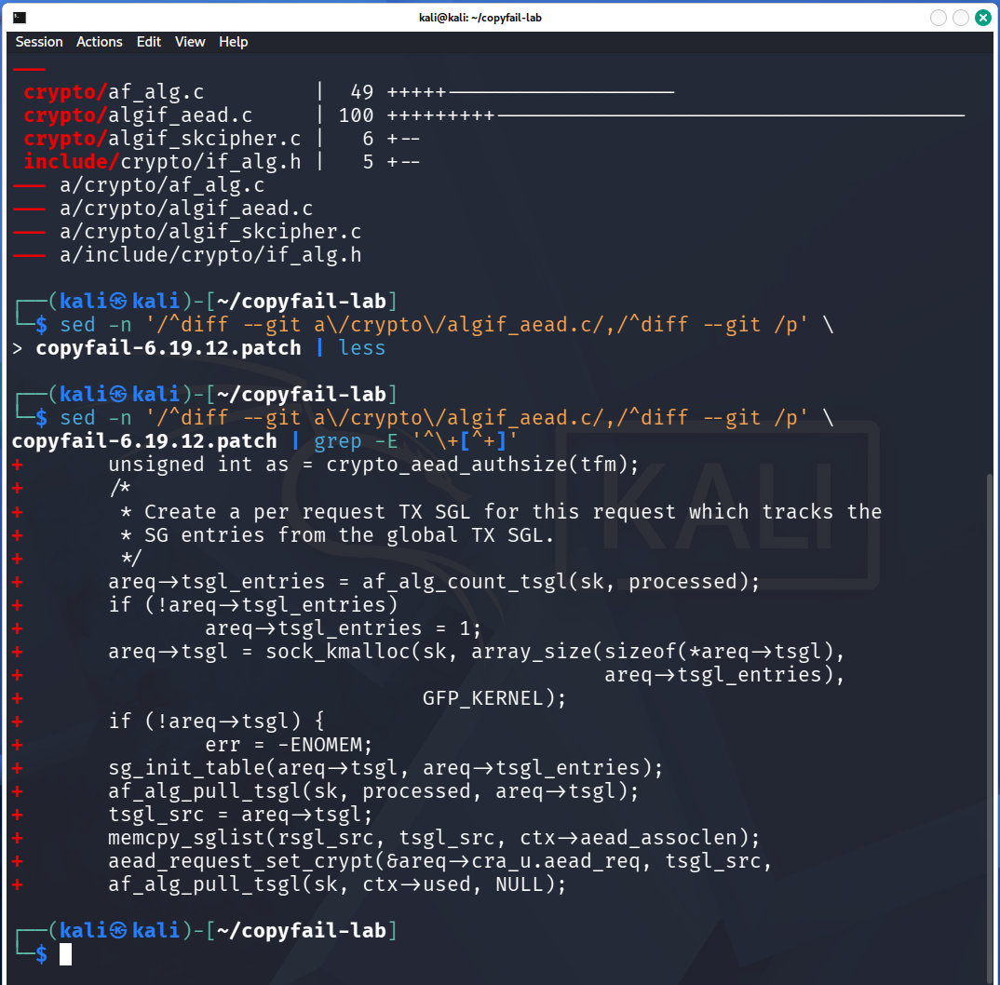

## 취약점 개요 {#overview}

> [!NOTE] 실습 범위
> 본 글은 공개 CVE와 공개 PoC를 바탕으로, 개인 소유의 격리 VirtualBox VM에서 수행한 방어 목적의 분석 기록이다. 운영 환경에서는 PoC를 실행하지 말고 배포판 보안 업데이트를 적용해야 한다.

CopyFail은 Linux 커널 AF_ALG 사용자 공간 암호화 인터페이스의 AEAD 처리 경로(`algif_aead`)에 존재했던 로컬 권한 상승 취약점이다. CVE 식별자는 **CVE-2026-31431**이다.

Linux CNA의 공개 정보에 따르면 이 문제는 Linux 4.14부터 존재했으며, Linux 6.19 안정 브랜치에서는 **6.19.12**에서 수정됐다. CVSS v3.1 점수는 7.8(High)이며, 벡터는 `CVSS:3.1/AV:L/AC:L/PR:L/UI:N/S:U/C:H/I:H/A:H`다. 원격 공격은 아니지만, 로컬의 일반 사용자 권한을 가진 공격자가 별도의 사용자 상호작용 없이 높은 권한을 얻을 수 있다는 의미다.

## 실험 환경 {#lab}

실습은 원본 Kali VM을 완전 복제한 뒤 진행했다. PoC 실행 전에는 네트워크, 공유 폴더, 공유 클립보드, 드래그 앤 드롭을 비활성화했다.

- 게스트 OS: Kali GNU/Linux Rolling 2026.2
- 가상화 환경: Oracle VirtualBox
- 취약 커널: 직접 빌드한 `6.19.11-copyfail-vuln`
- 수정 커널: Kali 기본 `6.19.14+kali-amd64`

GRUB에는 기본 Kali 커널과 직접 빌드한 취약 커널이 함께 나타났다. 재현 단계에서는 세 번째 항목인 `6.19.11-copyfail-vuln` 일반 부팅 항목을 선택했다.


취약 커널에서 `algif_aead` 모듈을 로드하고, 의존 모듈 `af_alg` 및 모듈의 vermagic가 의도한 취약 커널 버전과 일치하는지 확인했다.

```bash
uname -r
sudo modprobe algif_aead
modinfo algif_aead
lsmod | grep -E 'algif_aead|af_alg'
```

## 공개 PoC의 흐름 {#poc-flow}

공개 PoC 전체를 재배포하지 않고, 동작의 핵심만 정리한다.

1. `AF_ALG` 소켓을 만들고 AEAD 알고리즘을 바인딩한다.
2. `sendmsg()`로 AEAD 요청을 구성한다.
3. `splice()`를 두 번 사용해 대상 파일 페이지와 AF_ALG 소켓을 연결한다.
4. 이 과정을 파일의 여러 위치에 반복 적용한다.
5. 마지막으로 `su`를 실행해 권한 상태 변화를 확인한다.

PoC에는 `mmap()`이나 `execve()`라는 문자열이 직접 나타나지 않는다. 파일 페이지 이동에는 `splice()`를 사용하고, 프로그램 실행은 Python의 `os.system("su")`를 통해 이뤄지기 때문이다.

공개 PoC가 대상으로 삼는 `/usr/bin/su`는 setuid root 프로그램임을 확인했다.


## 재현 결과 {#result}

격리된 `6.19.11-copyfail-vuln` VM에서 공개 PoC를 실행한 뒤 `id`로 결과를 확인했다. 일반 사용자 세션에서 root 권한 획득이 확인됐다.

```text
uid=0(root) gid=0(root) groups=0(root)
```

반면 수정이 포함된 `6.19.14+kali-amd64`로 부팅한 Kali 환경에서 동일한 검증을 수행했을 때는 `su: Authentication failure`가 나타났고 root 권한을 얻지 못했다.

- `6.19.11-copyfail-vuln`: root 권한 획득 확인
- `6.19.14+kali-amd64`: 권한 상승 실패

## 루트코즈 {#root-cause}

커널은 여러 조각의 메모리를 scatter-gather list(SGL)로 표현한다. 취약점의 핵심은 기존 `algif_aead` 코드가 수신용 RX SGL을 암호 연산의 **입력(source)** 과 **출력(destination)** 양쪽에 함께 사용했다는 점이다. 이를 in-place 처리라고 한다.

하지만 AF_ALG 경로에서 입력과 출력은 서로 다른 메모리 매핑에서 비롯될 수 있다. 특히 PoC처럼 `splice()`로 파일 페이지를 연결하는 흐름에서는, 같은 SGL을 입력과 출력에 함께 쓰는 가정이 안전하지 않다. 그 결과 공격자가 의도한 파일 내용이 변경될 수 있었고, 공개 PoC는 setuid root 프로그램인 `/usr/bin/su`를 대상으로 그 영향을 확인한다.

아래는 패치에서 제거된 기존 in-place 처리의 설명과 코드 경로다. 기존 코드는 RX SGL을 source와 destination으로 함께 사용했다.


## 패치 분석 {#patch}

수정 커밋의 제목은 다음과 같다.

```text
crypto: algif_aead - Revert to operating out-of-place
```

패치 설명은 source와 destination이 서로 다른 매핑에서 왔으며 `algif_aead`에서 in-place 처리의 이점이 없다고 명시한다.

수정의 핵심은 요청별 TX SGL을 새로 만드는 것이다.

```text
기존: RX SGL -> source와 destination에 함께 사용
수정: TX SGL -> source
      RX SGL -> destination
```

패치에서는 `af_alg_count_tsgl()`로 필요한 TX SGL 엔트리 수를 계산하고, `sock_kmalloc()`으로 요청별 TX SGL을 할당한다. 이어서 `af_alg_pull_tsgl()`과 `memcpy_sglist()`를 이용해 입력을 별도 목록으로 준비한 뒤, `aead_request_set_crypt()`에 서로 다른 source와 destination을 전달한다. 즉, 입력과 출력을 분리한 out-of-place 처리로 변경해 잘못된 in-place 가정을 제거한 것이다.



## 대응 방안 {#mitigation}

가장 중요한 대응은 배포판 벤더가 제공하는 수정 커널로 업데이트하는 것이다. Linux 6.19 계열에서는 6.19.12에 수정이 포함됐다.

- 사용 중인 커널 버전과 배포판 보안 권고를 확인한다.
- 불필요한 AF_ALG 사용자 공간 인터페이스 노출을 검토한다.
- 로컬 일반 사용자 계정을 최소 권한으로 관리한다.
- setuid root 바이너리에 대한 파일 무결성 점검을 수행한다.

## 마무리 {#conclusion}

CopyFail은 암호 알고리즘 자체의 약점이 아니라, 커널이 암호 연산에 전달하는 입력·출력 메모리 목록을 잘못 공유한 구현 문제다. 격리된 실험에서 취약 커널은 권한 상승이 가능했고, 수정 커널에서는 동일 검증이 실패했다. 패치는 별도의 TX SGL을 도입해 source와 destination을 분리함으로써 문제를 해결한다.

## 참고 자료 {#references}

1. [Linux CNA: CVE-2026-31431 공개 안내](https://kernel.googlesource.com/pub/scm/linux/security/vulns/+/9b6ea0a8d798f08f86f2ece859fd2c51d76ce265/cve/published/2026/CVE-2026-31431.mbox)
2. [CVE Program: CVE-2026-31431 레코드](https://github.com/CVEProject/cvelistV5/blob/main/cves/2026/31xxx/CVE-2026-31431.json)
3. [Linux stable 수정 커밋 (6.19.12)](https://git.kernel.org/pub/scm/linux/kernel/git/stable/linux.git/commit/?id=ce42ee423e58dffa5ec03524054c9d8bfd4f6237)
4. [업스트림 수정 커밋](https://git.kernel.org/pub/scm/linux/kernel/git/torvalds/linux.git/commit/?id=a664bf3d603dc3bdcf9ae47cc21e0daec706d7a5)
5. [공개 PoC 저장소](https://github.com/theori-io/copy-fail-CVE-2026-31431)

> [!NEXT] 다음 기록
> 향후에는 AF_ALG의 다른 사용자 공간 인터페이스와 scatter-gather list의 메모리 관리 방식도 추가로 분석해 볼 예정이다.
