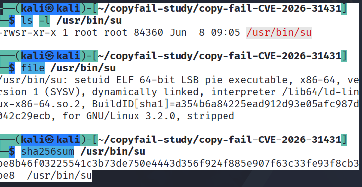
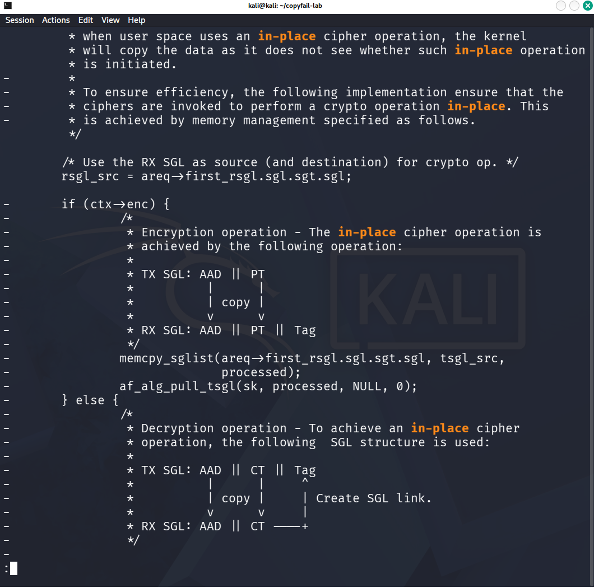

## 취약점 개요 {#overview}

> [!NOTE] 실습 범위
> 본 글은 공개 CVE와 공개 PoC를 바탕으로, 개인 소유의 격리 VirtualBox VM에서 수행한 방어 목적의 분석 기록이다. 운영 환경에서는 PoC를 실행하지 말고 배포판 보안 업데이트를 적용해야 한다.

이번 미션에서 분석한 CopyFail은 Linux 커널 AF_ALG 사용자 공간 암호화 인터페이스의 AEAD 처리 경로(`algif_aead`)에 있던 로컬 권한 상승 취약점이다. CVE 식별자는 **CVE-2026-31431**이다.

Linux CNA의 공개 정보에 따르면 이 문제는 Linux 4.14부터 존재했으며, Linux 6.19 안정 브랜치에서는 **6.19.12**에서 수정됐다. CVSS v3.1 점수는 7.8(High)이며, 벡터는 `CVSS:3.1/AV:L/AC:L/PR:L/UI:N/S:U/C:H/I:H/A:H`다. 원격 공격은 아니지만, 로컬의 일반 사용자 권한을 가진 공격자가 별도의 사용자 상호작용 없이 높은 권한을 얻을 수 있다는 의미다.

CVE 레코드가 명시한 영향을 받는 소스 파일은 `crypto/af_alg.c`, `crypto/algif_aead.c`, `crypto/algif_skcipher.c`, `include/crypto/if_alg.h`다. 버전은 단일 숫자 하나로 판단하면 안 된다. 현재 CVE JSON은 4.14부터 각 유지보수 브랜치의 수정 버전 이전을 취약 범위로 열거하며, 예를 들어 5.10.254 미만, 5.15.204 미만, 6.1.170 미만, 6.6.137 미만, 6.12.85 미만, 6.18.22 미만, 6.19.12 미만 및 7.0 이전 mainline을 각각 표시한다. 배포판이 패치를 백포트할 수 있으므로 실제 판단은 커널 버전 문자열과 배포판 보안 공지를 함께 봐야 한다. [CVE JSON의 affected 항목](https://github.com/CVEProject/cvelistV5/blob/main/cves/2026/31xxx/CVE-2026-31431.json)

이 취약점은 네트워크 서버에 원격으로 접속해 바로 악용하는 유형이 아니다. 공격자는 먼저 해당 시스템에서 코드를 실행할 수 있는 로컬 계정이 필요하다(`AV:L`, `PR:L`). 반면 추가 조작이나 피해자의 클릭은 필요하지 않으며(`AC:L`, `UI:N`), 성공하면 기밀성·무결성·가용성 모두에 높은 영향이 생긴다(`C:H/I:H/A:H`). CVE 레코드의 CWE 분류는 자료원에 따라 다르게 표시되므로, 이 글에서는 커널의 메모리 매핑과 버퍼 처리 오류라는 기술적 원인에 초점을 맞춘다.

현재 CVE 레코드의 CISA ADP 항목은 이 문제를 **CWE-669(Incorrect Resource Transfer Between Spheres)**로 분류한다. 여기서 말하는 sphere는 신뢰 경계가 다른 자원 영역을 뜻한다. 이 글의 기술 분석에서 “읽기 전용 파일의 페이지 캐시가 암호 연산의 쓰기 대상에 들어간다”고 설명하는 부분과 연결된다. 단, CWE는 원인에 대한 분류이고, 실제 수정 여부는 커널의 해당 패치가 반영됐는지로 판단해야 한다.

## 먼저 알아둘 개념 {#concepts}

### AF_ALG는 무엇인가

AF_ALG는 애플리케이션이 커널의 암호화 기능을 소켓 인터페이스로 사용할 수 있게 해 주는 Linux API다. 프로그램은 알고리즘 이름과 키, 입력 데이터를 커널에 전달하고, 커널의 Crypto API가 실제 암호 연산을 수행한다. `algif_aead`는 그중 AEAD 요청을 사용자 공간과 연결하는 모듈이다.

### AEAD는 무엇인가

AEAD는 데이터를 암호화하면서 동시에 무결성 인증 태그를 만드는 방식이다. AES-GCM이나 ChaCha20-Poly1305처럼 암호문과 인증 태그를 함께 다루는 알고리즘이 대표적이다. 이 취약점은 특정 알고리즘의 수학적 약점이 아니라, AEAD 요청에 전달되는 메모리 목록을 커널이 구성하는 과정에서 발생했다.

### SGL과 in-place / out-of-place

커널은 하나로 이어지지 않은 여러 메모리 조각을 scatter-gather list(SGL)로 묶어 암호화 함수에 전달할 수 있다. 입력과 출력이 같은 버퍼를 가리키면 in-place 처리이고, 입력용 버퍼와 출력용 버퍼를 분리하면 out-of-place 처리다. 두 방식은 단순한 성능 선택이 아니라, 각 버퍼가 어떤 메모리 매핑을 가리키는지에 따라 안전성이 달라진다.

### `splice()`가 왜 등장하는가

`splice()`는 사용자 공간으로 데이터를 복사하지 않고 파일·파이프·소켓 사이에서 커널의 페이지 참조를 연결하는 Linux 시스템 콜이다. 따라서 파일의 페이지가 일반적인 복사 버퍼와 다르게 암호 연산 경로에 들어갈 수 있다. 공개 PoC는 이 특성과 AF_ALG의 SGL 처리를 함께 이용한다.

### 페이지 캐시와 디스크 원본은 같은 것이 아니다

프로그램이 파일을 읽으면 커널은 파일 내용을 페이지 캐시에 올려두고 이후 접근에 재사용한다. 실행 파일을 다시 실행할 때도 디스크를 매번 읽는 것이 아니라 이미 캐시에 있는 페이지를 사용할 수 있다. 따라서 디스크의 파일이 바뀌었는지와 현재 메모리에 올라온 파일 페이지가 바뀌었는지는 별도로 생각해야 한다.

CopyFail의 공격 프리미티브는 디스크 파일을 직접 쓰는 것이 아니라, 읽기 권한만 있는 파일의 페이지 캐시를 바꾸는 것이다. 그래서 디스크 원본은 그대로 남지만, 해당 페이지가 캐시에 남아 있는 동안 실행되는 프로그램은 변조된 내용을 볼 수 있다. 일반적인 파일 해시만 확인하는 방식으로는 이 차이를 놓칠 수 있다.

## 실험 환경 {#lab}

처음부터 원본 Kali에서 실행하기는 불안해서 VM을 통째로 복제했다. PoC를 돌릴 때는 네트워크와 공유 폴더, 공유 클립보드, 드래그 앤 드롭도 꺼 뒀다.

- 게스트 OS: Kali GNU/Linux Rolling 2026.2
- 가상화 환경: Oracle VirtualBox
- 취약 커널: 직접 빌드한 `6.19.11-copyfail-vuln`
- 수정 커널: Kali 기본 `6.19.14+kali-amd64`

GRUB에는 기본 Kali 커널과 직접 빌드한 취약 커널이 함께 나타났다. 재현 단계에서는 세 번째 항목인 `6.19.11-copyfail-vuln` 일반 부팅 항목을 선택했다.

취약 커널에서 `uname -r`로 부팅 버전을 확인한 뒤 `algif_aead` 모듈을 로드했다. 이어 `modinfo`와 `lsmod` 출력으로 의존 모듈 `af_alg`가 함께 로드됐고, vermagic가 의도한 취약 커널 버전과 일치하는지도 확인했다.

## 이 글에서 말하는 “확인”의 기준 {#evidence}

주장을 세 종류로 나눴다.

- **공식 사실:** CVE JSON의 CVSS·영향 파일·버전 범위, Linux 커널의 수정 커밋과 diff에서 직접 확인되는 내용이다.
- **공개 분석:** Xint/Theori가 커널 소스와 PoC를 추적해 설명한 페이지 캐시·`authencesn`·4바이트 쓰기 경로다. 공식 커밋 메시지보다 상세하지만, 연구팀의 분석이라는 점을 표시했다.
- **직접 실험:** 이 글의 VirtualBox Kali 환경에서 `uname -r`, 모듈 상태, 취약 커널의 root 획득, 수정 커널의 실패를 직접 확인한 결과다.

따라서 공개 연구팀이 다른 배포판에서 성공했다고 해서 그것을 우리 VM에서 확인한 것처럼 쓰지 않았고, 반대로 우리 Kali 결과만으로 모든 배포판의 상태를 단정하지 않았다.

## 공개 PoC의 흐름 {#poc-flow}

코드는 짧지만 처음 보면 의도가 잘 보이지 않았다. 전체 코드를 옮기지는 않고, 내가 따라가며 이해한 흐름만 정리했다.

1. `AF_ALG` 소켓을 만들고 AEAD 알고리즘을 바인딩한다.
2. `sendmsg()`로 AEAD 요청을 구성한다.
3. `splice()`를 두 번 사용해 대상 파일 페이지와 AF_ALG 소켓을 연결한다.
4. 이 과정을 파일의 여러 위치에 반복 적용한다.
5. 마지막으로 `su`를 실행해 권한 상태 변화를 확인한다.

처음에는 `mmap()`이나 `execve()`가 안 보여서 내가 잘못 찾았나 싶었다. 다시 보니 파일 페이지 이동은 `splice()`가 맡고, 마지막 실행은 Python의 `os.system("su")`로 처리하고 있었다.

공개 PoC가 대상으로 삼는 `/usr/bin/su`는 setuid root 프로그램임을 확인했다.

공격 흐름을 한 줄로 줄이면 다음과 같다. 로컬 일반 사용자가 AF_ALG AEAD 요청을 만들고, `splice()`로 파일 페이지를 해당 요청의 메모리 경로에 연결한 뒤, 취약한 in-place 처리의 차이를 이용해 setuid 프로그램의 파일 내용을 바꾸고 `su`를 실행하는 구조다. 따라서 PoC의 각 줄을 따로 보면 단순한 암호화 코드처럼 보이지만, 실제 핵심은 “어떤 페이지가 source와 destination으로 연결되는가”에 있다.

## 취약점이 만들어진 과정 {#history}

이 문제는 한 번의 잘못된 코드보다 서로 다른 시기의 설계가 겹치면서 생겼다.

1. `authencesn`은 IPsec의 Extended Sequence Number(ESN)를 처리하기 위해 AAD 안의 시퀀스 번호를 잠시 재배치한다. 이 과정에서 destination을 임시 저장 공간처럼 사용한다.
2. 2015년 AF_ALG에 AEAD 지원이 들어왔을 때는 입력과 출력 SGL이 분리되어 있었다. 따라서 임시 쓰기는 사용자가 제공한 출력 버퍼 안에서 끝났다.
3. 2017년 `algif_aead` 최적화가 복호화를 in-place 방식으로 바꾸면서 입력과 출력이 같은 SGL을 공유하게 됐다. 이때 `splice()`로 들어온 파일 페이지가 출력 목록 뒤쪽에 연결될 수 있는 조건이 만들어졌다.
4. 이후 `authencesn`의 범위를 벗어난 임시 쓰기가 그 연결된 파일 페이지에 도달하면서, 읽기 전용 파일의 페이지 캐시를 4바이트씩 바꿀 수 있게 됐다.

각 변경만 따로 보면 성능 최적화나 프로토콜 처리를 위한 합리적인 코드였지만, 세 경로가 만나는 지점에서 신뢰 경계가 무너졌다.

## 재현 결과 {#result}

`6.19.11-copyfail-vuln`으로 부팅한 VM에서 PoC를 실행한 뒤 `id`를 확인했다. 출력에 `uid=0(root) gid=0(root) groups=0(root)`가 나온 순간에는, 커널 버전을 바꿔서 검증해야 했던 이유가 확실히 와닿았다.

반대로 수정이 들어간 `6.19.14+kali-amd64`에서는 같은 검증을 했을 때 `su: Authentication failure`가 나왔고 root가 되지 않았다. 단순히 PoC가 한 번 성공한 것이 아니라, 패치 전후에 결과가 갈린다는 점까지 확인할 수 있었다.

- `6.19.11-copyfail-vuln`: root 권한 획득 확인
- `6.19.14+kali-amd64`: 권한 상승 실패

## 루트코즈 {#root-cause}

이 절에서는 근거의 성격을 나눠서 읽어야 한다. Linux CNA/CVE 레코드와 공식 커밋은 “`algif_aead`의 in-place 처리를 되돌리고 source와 destination을 분리한다”는 사실을 직접 확인해 준다. `authencesn`의 4바이트 scratch write, 페이지 캐시가 실제로 쓰이는 위치, HMAC 실패 후에도 쓰기가 남는 순서는 공개 연구팀의 코드 분석과 PoC 동작 설명을 통해 보강되는 세부 사항이다. 따라서 아래 세부 경로는 [Xint의 공개 기술 분석](https://xint.io/blog/copy-fail-linux-distributions)을 근거로 삼고, 우리 실습에서 직접 확인한 것은 취약·수정 커널의 실행 결과로 구분한다.

처음에는 SGL이라는 말부터 낯설었다. 커널은 여러 조각의 메모리를 scatter-gather list(SGL)로 묶어 다룬다. 문제는 기존 `algif_aead` 코드가 수신용 RX SGL 하나를 암호 연산의 **입력(source)** 과 **출력(destination)** 양쪽에 같이 썼다는 데 있다. 이런 방식을 in-place 처리라고 한다.

그런데 AF_ALG 경로에서는 입력과 출력이 서로 다른 메모리 매핑에서 올 수 있다. `splice()`로 파일 페이지를 이어 붙이는 PoC 흐름에서는 특히 그렇다. 그래서 RX SGL 하나를 양쪽에 써도 된다는 가정이 깨지고, 파일 내용이 바뀔 수 있는 상태가 만들어진다. 공개 PoC가 setuid root 프로그램인 `/usr/bin/su`를 대상으로 삼는 이유도 여기에 있다.

공개 분석에서 지적된 핵심 세부 사항은 `authencesn`의 복호화 경로가 정상 출력 범위를 벗어난 위치를 임시 저장 공간으로 사용한다는 점이다. ESN의 시퀀스 번호를 HMAC 입력에 맞게 재배치하면서 AAD 일부를 읽고 덮어쓰는데, 마지막 4바이트 쓰기의 위치가 `assoclen + cryptlen` 뒤쪽으로 잡힌다. 별도의 destination이라면 문제가 드러나지 않지만, in-place SGL 뒤에 파일 페이지가 연결된 상태에서는 그 위치가 페이지 캐시가 된다.

PoC는 암호문을 정상적으로 인증하려는 것이 아니다. 공격자가 원하는 4바이트를 AAD의 시퀀스 번호 위치에 넣고, `splice()` 길이와 AEAD 길이를 조절해 그 값이 파일의 원하는 오프셋에 떨어지게 만든다. HMAC 검증은 실패해도 문제의 쓰기가 먼저 일어나므로, `recv()`가 오류를 반환한 뒤에도 페이지 캐시의 변경은 남는다.

아래는 패치에서 제거된 기존 in-place 처리의 설명과 코드 경로다. 기존 코드는 RX SGL을 source와 destination으로 함께 사용했다.

## 패치 분석 {#patch}

수정 커밋의 제목은 **crypto: algif_aead - Revert to operating out-of-place**다.

커밋 메시지도 source와 destination이 서로 다른 매핑에서 왔고, `algif_aead`에서 굳이 in-place로 처리할 이유가 없다고 설명한다.

수정의 핵심은 요청별 TX SGL을 새로 만드는 것이다. 기존에는 RX SGL 하나가 source와 destination을 모두 맡았지만, 수정 뒤에는 TX SGL이 source를 맡고 RX SGL은 destination으로만 쓰인다.

diff를 보면 `af_alg_count_tsgl()`로 TX SGL 크기를 구하고, `sock_kmalloc()`으로 요청마다 새 TX SGL을 만든다. 그 뒤 `af_alg_pull_tsgl()`과 `memcpy_sglist()`로 입력을 따로 준비하고, `aead_request_set_crypt()`에는 서로 다른 source와 destination을 넘긴다. 결국 입력과 출력을 분리하는 out-of-place 처리로 돌아간 것이다.

패치에서 `crypto/algif_aead.c`만 바뀐 것은 아니다. 공통 AF_ALG 보조 코드인 `crypto/af_alg.c`, 대칭키 경로인 `crypto/algif_skcipher.c`, 관련 자료구조가 선언된 `include/crypto/if_alg.h`도 함께 조정됐다. 즉, 한 함수의 조건문을 고친 것이 아니라 SGL을 준비하고 요청 수명 동안 관리하는 공통 경로까지 맞춘 수정이다.

공식 diff에서 확인되는 전후 차이는 명확하다. 기존 복호화 경로는 AAD와 ciphertext를 RX SGL로 복사한 뒤 TX 쪽 tag SGL을 `sg_chain()`으로 RX 목록 끝에 연결하고, 같은 RX 목록을 source와 destination으로 사용했다. 수정 후에는 이 체인 경로가 삭제되고, `aead_request_set_crypt()`의 source에는 요청별 TX SGL, destination에는 RX SGL이 들어간다. 따라서 `splice()`로 들어온 페이지가 source에 남더라도, 암호 함수의 쓰기는 사용자 출력용 destination으로 제한된다. [업스트림 수정 커밋의 diff](https://github.com/torvalds/linux/commit/a664bf3d603dc3bdcf9ae47cc21e0daec706d7a5)

## 4바이트 쓰기에서 root 셸까지 {#payload}

공개 PoC에 들어 있는 압축 데이터는 작은 x86-64 ELF 페이로드로 풀린다. 한 번의 요청으로 바뀌는 단위는 4바이트이므로, 페이로드를 4바이트씩 잘라 파일의 연속된 오프셋에 반복해서 기록한다. 이 반복은 PoC가 임의로 정한 형식이 아니라, 커널 내부에서 `authencesn`이 범위를 벗어나 쓰는 크기가 4바이트이기 때문에 필요하다.

PoC가 실행하는 순서는 다음과 같다.

1. `/usr/bin/su`를 읽기 전용으로 연다.
2. 압축된 ELF 페이로드를 풀고 4바이트 조각으로 나눈다.
3. 각 조각마다 AF_ALG 요청과 `splice()`를 수행해 해당 파일 오프셋의 페이지 캐시에 기록한다.
4. 모든 조각을 기록한 뒤 `su`를 실행한다.
5. `su`는 디스크 원본이 아니라 변조된 페이지 캐시의 ELF를 읽고 실행하므로 root 권한의 셸이 열린다.

따라서 이 공격은 디스크 파일을 영구적으로 덮어쓰는 방식이 아니다. 재부팅하거나 페이지 캐시가 교체되면 원래 파일 내용으로 돌아갈 수 있지만, 변조된 상태에서 실행된 프로세스의 권한 상승은 이미 발생한 뒤다.

## 직접 확인한 범위와 일반화의 한계 {#scope}

이번 실습에서 직접 확인한 조합은 Kali Rolling 2026.2의 `6.19.11-copyfail-vuln`과 `6.19.14+kali-amd64`다. 전자는 root 권한 획득에 성공했고 후자는 실패했다. 공개 연구팀이 별도로 검증한 Ubuntu, Amazon Linux, RHEL, SUSE 조합은 참고 자료의 테스트 결과이며, 이 실습에서 직접 실행한 결과와 구분해야 한다.

따라서 “모든 Linux가 취약하다”라고 단정하기보다, 2017년 in-place 변경이 포함되고 수정 커밋이 반영되지 않은 커널이 영향 대상이라고 표현하는 것이 정확하다. 배포판은 같은 커널 버전 숫자라도 보안 패치를 백포트할 수 있으므로, 숫자만 보지 말고 배포판의 보안 권고와 실제 패치 상태를 확인해야 한다.

공개 연구팀이 직접 시험했다고 밝힌 조합은 Ubuntu 24.04 LTS의 6.17.0-1007-aws, Amazon Linux 2023의 6.18.8-9.213.amzn2023, RHEL 10.1의 6.12.0-124.45.1.el10_1, SUSE 16의 6.12.0-160000.9-default다. 이 표는 연구팀의 재현 매트릭스이지 CVE의 모든 영향 버전을 대신하는 목록은 아니다. 우리 실습의 Kali 결과와 이 네 조합의 결과를 섞어 쓰지 않도록 구분했다. [공개 재현 결과](https://xint.io/blog/copy-fail-linux-distributions#the-demo)

## 대응 방안 {#mitigation}

가장 중요한 대응은 배포판 벤더가 제공하는 수정 커널로 업데이트하는 것이다. Linux 6.19 계열에서는 6.19.12에 수정이 포함됐다.

- 사용 중인 커널 버전과 배포판 보안 권고를 확인한다.
- 불필요한 AF_ALG 사용자 공간 인터페이스 노출을 검토한다.
- 로컬 일반 사용자 계정을 최소 권한으로 관리한다.
- setuid root 바이너리에 대한 파일 무결성 점검을 수행한다.

패치가 바로 어려운 경우 공개 완화책은 `algif_aead`의 자동 적재를 막고 이미 적재된 모듈을 내리는 것이다. 다만 이 방법은 AF_ALG를 실제로 사용하는 애플리케이션을 중단시킬 수 있고, 이미 모듈이 올라온 상태에서는 설정 파일만 추가해도 소급 적용되지 않는다. 따라서 임시 완화책은 패치의 대체물이 아니라 패치 전까지의 방어층으로 봐야 한다. 컨테이너나 CI처럼 신뢰할 수 없는 코드를 실행하는 환경에서는 seccomp로 AF_ALG 소켓 생성 자체를 제한하는 방안도 검토할 수 있다. 구체적인 운영 적용은 배포판 권고와 해당 시스템의 AF_ALG 사용 여부를 확인한 뒤 결정해야 한다.

## 공개 일정 {#timeline}

공식 공개 페이지의 기록은 2026년 3월 23일 Linux 커널 보안팀에 보고, 3월 25일 패치 제안·검토, 4월 1일 메인라인 커밋, 4월 22일 CVE 할당, 4월 29일 공개 순서로 정리돼 있다. 이 일정은 취약점의 기술 원인과는 별개지만, 수정 커밋과 CVE 번호의 관계를 확인하는 데 유용하다. [Copy Fail 공개 일정](https://copy.fail/)

## 실습 중 어려웠던 점 {#challenges}

제일 먼저 막힌 건 커널 빌드 준비였다. Kali의 지역 미러에서 패키지를 받으려는데 403, 520, 인증서 검증 오류가 연달아 났다. 처음에는 명령어를 잘못 쳤다고 생각했는데, 미러 쪽 문제였다. 패키지 소스를 공식 Kali 다운로드 서버로 바꾸고 시스템 시간도 확인한 뒤에야 필요한 도구를 설치할 수 있었다.

커널 전체 빌드는 생각보다 훨씬 오래 걸렸다. 진행 막대도 없어서 멈춘 건지 구분하기 어려웠다. 그래서 다른 터미널에서 컴파일된 오브젝트 수와 빌드 폴더 크기가 늘어나는지를 보면서 기다렸다. 중간에 복사하려다 `Ctrl+C`를 잘못 눌러 빌드를 끊기도 했지만, 같은 `make` 명령을 다시 실행하니 처음부터 하지 않고 이어서 빌드됐다.

GRUB에 기존 Kali 커널과 직접 빌드한 커널이 같이 보이는 것도 헷갈렸다. 처음에는 수정된 `6.19.14+kali-amd64`로 부팅한 줄 모르고 PoC를 돌렸고, 당연히 권한 상승이 안 됐다. 그 뒤에는 부팅할 때마다 `uname -r`부터 확인했다. 이 실수 덕분에 오히려 취약 커널과 수정 커널의 결과를 비교하는 기준이 더 분명해졌다.

PoC도 처음에는 읽기 쉽지 않았다. 코드가 압축돼 있고 함수 이름도 짧아서 `recvmsg`, `mmap`, `execve`가 왜 안 보이는지부터 헷갈렸다. Python API와 시스템 콜을 하나씩 맞춰 보니 `splice()`는 파일 페이지 이동, `os.system("su")`는 실행 역할이라는 게 보였다. 그 뒤에야 PoC가 패치의 어느 부분을 건드리는지 연결할 수 있었다.

## 마무리 {#conclusion}

이번 분석을 하면서 가장 크게 남은 건, 암호 알고리즘이 멀쩡해도 주변의 메모리 처리 방식 하나가 권한 상승으로 이어질 수 있다는 점이었다. 취약 커널에서는 root가 됐고 수정 커널에서는 실패했다. 패치가 TX SGL을 따로 만들어 source와 destination을 나눈 이유도, 직접 PoC 결과와 diff를 같이 보니 훨씬 이해하기 쉬웠다.

## 참고 자료 {#references}

1. [Linux CNA: CVE-2026-31431 공개 안내](https://kernel.googlesource.com/pub/scm/linux/security/vulns/+/9b6ea0a8d798f08f86f2ece859fd2c51d76ce265/cve/published/2026/CVE-2026-31431.mbox)
2. [CVE Program: CVE-2026-31431 레코드](https://github.com/CVEProject/cvelistV5/blob/main/cves/2026/31xxx/CVE-2026-31431.json)
3. [Linux stable 수정 커밋 (6.19.12)](https://git.kernel.org/pub/scm/linux/kernel/git/stable/linux.git/commit/?id=ce42ee423e58dffa5ec03524054c9d8bfd4f6237)
4. [업스트림 수정 커밋](https://git.kernel.org/pub/scm/linux/kernel/git/torvalds/linux.git/commit/?id=a664bf3d603dc3bdcf9ae47cc21e0daec706d7a5)
5. [공개 PoC 저장소](https://github.com/theori-io/copy-fail-CVE-2026-31431)

> [!NEXT] 다음 기록
> 향후에는 AF_ALG의 다른 사용자 공간 인터페이스와 scatter-gather list의 메모리 관리 방식도 추가로 분석해 볼 예정이다.
