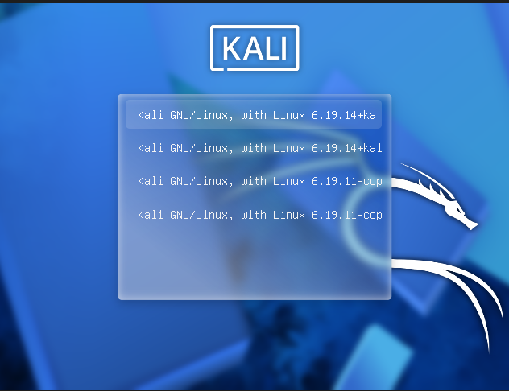

## 취약점 개요 {#overview}

> [!NOTE] 실습 범위
> 본 글은 공개 CVE와 공개 PoC를 바탕으로, 개인 소유의 격리 VirtualBox VM에서 수행한 방어 목적의 분석 기록이다. 운영 환경에서는 PoC를 실행하지 말고 배포판 보안 업데이트를 적용해야 한다.

이번 미션에서 분석한 CopyFail은 Linux 커널 AF_ALG 사용자 공간 암호화 인터페이스의 AEAD 처리 경로(`algif_aead`)에 있던 로컬 권한 상승 취약점이다. CVE 식별자는 **CVE-2026-31431**이다.

Linux CNA의 공개 정보에 따르면 이 문제는 Linux 4.14부터 존재했으며, Linux 6.19 안정 브랜치에서는 **6.19.12**에서 수정됐다. CVSS v3.1 점수는 7.8(High)이며, 벡터는 `CVSS:3.1/AV:L/AC:L/PR:L/UI:N/S:U/C:H/I:H/A:H`다. 원격 공격은 아니지만, 로컬의 일반 사용자 권한을 가진 공격자가 별도의 사용자 상호작용 없이 높은 권한을 얻을 수 있다는 의미다.

## 실험 환경 {#lab}

처음부터 원본 Kali에서 실행하기는 불안해서 VM을 통째로 복제했다. PoC를 돌릴 때는 네트워크와 공유 폴더, 공유 클립보드, 드래그 앤 드롭도 꺼 뒀다.

- 게스트 OS: Kali GNU/Linux Rolling 2026.2
- 가상화 환경: Oracle VirtualBox
- 취약 커널: 직접 빌드한 `6.19.11-copyfail-vuln`
- 수정 커널: Kali 기본 `6.19.14+kali-amd64`

GRUB에는 기본 Kali 커널과 직접 빌드한 취약 커널이 함께 나타났다. 재현 단계에서는 세 번째 항목인 `6.19.11-copyfail-vuln` 일반 부팅 항목을 선택했다.



취약 커널에서 `algif_aead` 모듈을 로드하고, 의존 모듈 `af_alg` 및 모듈의 vermagic가 의도한 취약 커널 버전과 일치하는지 확인했다.

```bash
uname -r
sudo modprobe algif_aead
modinfo algif_aead
lsmod | grep -E 'algif_aead|af_alg'
```

## 공개 PoC의 흐름 {#poc-flow}

코드는 짧지만 처음 보면 의도가 잘 보이지 않았다. 전체 코드를 옮기지는 않고, 내가 따라가며 이해한 흐름만 정리했다.

1. `AF_ALG` 소켓을 만들고 AEAD 알고리즘을 바인딩한다.
2. `sendmsg()`로 AEAD 요청을 구성한다.
3. `splice()`를 두 번 사용해 대상 파일 페이지와 AF_ALG 소켓을 연결한다.
4. 이 과정을 파일의 여러 위치에 반복 적용한다.
5. 마지막으로 `su`를 실행해 권한 상태 변화를 확인한다.

처음에는 `mmap()`이나 `execve()`가 안 보여서 내가 잘못 찾았나 싶었다. 다시 보니 파일 페이지 이동은 `splice()`가 맡고, 마지막 실행은 Python의 `os.system("su")`로 처리하고 있었다.

공개 PoC가 대상으로 삼는 `/usr/bin/su`는 setuid root 프로그램임을 확인했다.


## 재현 결과 {#result}

`6.19.11-copyfail-vuln`으로 부팅한 VM에서 PoC를 실행한 뒤 `id`를 확인했다. 처음으로 `uid=0(root)`가 나온 순간에는, 커널 버전을 바꿔서 검증해야 했던 이유가 확실히 와닿았다.

```text
uid=0(root) gid=0(root) groups=0(root)
```

반대로 수정이 들어간 `6.19.14+kali-amd64`에서는 같은 검증을 했을 때 `su: Authentication failure`가 나왔고 root가 되지 않았다. 단순히 PoC가 한 번 성공한 것이 아니라, 패치 전후에 결과가 갈린다는 점까지 확인할 수 있었다.

- `6.19.11-copyfail-vuln`: root 권한 획득 확인
- `6.19.14+kali-amd64`: 권한 상승 실패

## 루트코즈 {#root-cause}

처음에는 SGL이라는 말부터 낯설었다. 커널은 여러 조각의 메모리를 scatter-gather list(SGL)로 묶어 다룬다. 문제는 기존 `algif_aead` 코드가 수신용 RX SGL 하나를 암호 연산의 **입력(source)** 과 **출력(destination)** 양쪽에 같이 썼다는 데 있다. 이런 방식을 in-place 처리라고 한다.

그런데 AF_ALG 경로에서는 입력과 출력이 서로 다른 메모리 매핑에서 올 수 있다. `splice()`로 파일 페이지를 이어 붙이는 PoC 흐름에서는 특히 그렇다. 그래서 RX SGL 하나를 양쪽에 써도 된다는 가정이 깨지고, 파일 내용이 바뀔 수 있는 상태가 만들어진다. 공개 PoC가 setuid root 프로그램인 `/usr/bin/su`를 대상으로 삼는 이유도 여기에 있다.

아래는 패치에서 제거된 기존 in-place 처리의 설명과 코드 경로다. 기존 코드는 RX SGL을 source와 destination으로 함께 사용했다.


## 패치 분석 {#patch}

수정 커밋의 제목은 다음과 같다.

```text
crypto: algif_aead - Revert to operating out-of-place
```

커밋 메시지도 source와 destination이 서로 다른 매핑에서 왔고, `algif_aead`에서 굳이 in-place로 처리할 이유가 없다고 설명한다.

수정의 핵심은 요청별 TX SGL을 새로 만드는 것이다.

```text
기존: RX SGL -> source와 destination에 함께 사용
수정: TX SGL -> source
      RX SGL -> destination
```

diff를 보면 `af_alg_count_tsgl()`로 TX SGL 크기를 구하고, `sock_kmalloc()`으로 요청마다 새 TX SGL을 만든다. 그 뒤 `af_alg_pull_tsgl()`과 `memcpy_sglist()`로 입력을 따로 준비하고, `aead_request_set_crypt()`에는 서로 다른 source와 destination을 넘긴다. 결국 입력과 출력을 분리하는 out-of-place 처리로 돌아간 것이다.


## 대응 방안 {#mitigation}

가장 중요한 대응은 배포판 벤더가 제공하는 수정 커널로 업데이트하는 것이다. Linux 6.19 계열에서는 6.19.12에 수정이 포함됐다.

- 사용 중인 커널 버전과 배포판 보안 권고를 확인한다.
- 불필요한 AF_ALG 사용자 공간 인터페이스 노출을 검토한다.
- 로컬 일반 사용자 계정을 최소 권한으로 관리한다.
- setuid root 바이너리에 대한 파일 무결성 점검을 수행한다.

## 실습 중 어려웠던 점 {#challenges}

제일 먼저 막힌 건 커널 빌드 준비였다. Kali의 지역 미러에서 패키지를 받으려는데 403, 520, 인증서 검증 오류가 연달아 났다. 처음에는 명령어를 잘못 쳤다고 생각했는데, 미러 쪽 문제였다. 패키지 소스를 공식 Kali 다운로드 서버로 바꾸고 시스템 시간도 확인한 뒤에야 필요한 도구를 설치할 수 있었다.

커널 전체 빌드는 생각보다 훨씬 오래 걸렸다. 진행 막대도 없어서 멈춘 건지 구분하기 어려웠다. 그래서 다른 터미널에서 컴파일된 오브젝트 수와 빌드 폴더 크기가 늘어나는지를 보면서 기다렸다. 중간에 복사하려다 `Ctrl+C`를 잘못 눌러 빌드를 끊기도 했지만, 같은 `make` 명령을 다시 실행하니 처음부터 하지 않고 이어서 빌드됐다.

GRUB에 기존 Kali 커널과 직접 빌드한 커널이 같이 보이는 것도 헷갈렸다. 처음에는 수정된 `6.19.14+kali-amd64`로 부팅한 줄 모르고 PoC를 돌렸고, 당연히 권한 상승이 안 됐다. 그 뒤에는 부팅할 때마다 `uname -r`부터 확인했다. 이 실수 덕분에 오히려 취약 커널과 수정 커널의 결과를 비교하는 기준이 더 분명해졌다.

PoC도 처음에는 읽기 쉽지 않았다. 코드가 압축돼 있고 함수 이름도 짧아서 `recvmsg`, `mmap`, `execve`가 왜 안 보이는지부터 헷갈렸다. Python API와 시스템 콜을 하나씩 맞춰 보니 `splice()`는 파일 페이지 이동, `os.system("su")`는 실행 역할이라는 게 보였다. 그 뒤에야 PoC가 패치의 어느 부분을 건드리는지 연결할 수 있었다.

## 마무리 {#conclusion}

이번 분석을 하면서 가장 크게 남은 건, 암호 알고리즘이 멀쩡해도 주변의 메모리 처리 방식 하나가 권한 상승으로 이어질 수 있다는 점이었다. 취약 커널에서는 root가 됐고 수정 커널에서는 실패했다. 패치가 TX SGL을 따로 만들어 source와 destination을 나눈 이유도, 직접 PoC 결과와 diff를 같이 보니 훨씬 이해하기 쉬웠다.

## 참고 자료 {#references}

1. [Linux CNA: CVE-2026-31431 공개 안내](https://kernel.googlesource.com/pub/scm/linux/security/vulns/+/9b6ea0a8d798f08f86f2ece859fd2c51d76ce265/cve/published/2026/CVE-2026-31431.mbox)
2. [CVE Program: CVE-2026-31431 레코드](https://github.com/CVEProject/cvelistV5/blob/main/cves/2026/31xxx/CVE-2026-31431.json)
3. [Linux stable 수정 커밋 (6.19.12)](https://git.kernel.org/pub/scm/linux/kernel/git/stable/linux.git/commit/?id=ce42ee423e58dffa5ec03524054c9d8bfd4f6237)
4. [업스트림 수정 커밋](https://git.kernel.org/pub/scm/linux/kernel/git/torvalds/linux.git/commit/?id=a664bf3d603dc3bdcf9ae47cc21e0daec706d7a5)
5. [공개 PoC 저장소](https://github.com/theori-io/copy-fail-CVE-2026-31431)

> [!NEXT] 다음 기록
> 향후에는 AF_ALG의 다른 사용자 공간 인터페이스와 scatter-gather list의 메모리 관리 방식도 추가로 분석해 볼 예정이다.
